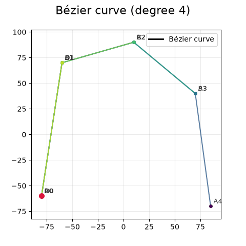
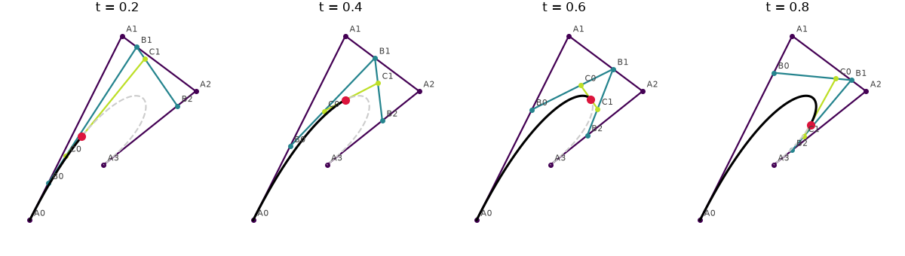

# beziervis

**Watch a Bézier curve build itself, and evaluate millions of curve points with a fast NumPy core.**

[](https://github.com/venkateshwara-gopisetti/Bezier-Curves/actions/workflows/tests.yml)
[](https://pypi.org/project/beziervis/)
[](https://pypi.org/project/beziervis/)
[](LICENSE)
[](https://colab.research.google.com/github/venkateshwara-gopisetti/Bezier-Curves/blob/master/examples/quickstart.ipynb)

<p align="center">
  
</p>

## Install

```bash
pip install beziervis            # core: NumPy only
pip install "beziervis[all]"     # + Numba acceleration and matplotlib animations
```

The extras can also be installed separately: `[fast]` adds Numba and `[anim]` adds matplotlib and Pillow.

## Get points

```python
import beziervis as bv

pts = bv.points([[0, 0], [5, 10], [9, 7], [4, 3]], n=200)   # (200, 2) NumPy array
```

Control points can be a list or an array, in any dimension (`(k, d)` gives `(n, d)` points).

## Make a GIF

```python
bv.animate([[0, 0], [5, 10], [9, 7], [4, 3]], verbose=True).save("curve.gif")
```

`.show()` opens a window instead. In Jupyter, the animation plays inline. From a terminal:

```bash
beziervis --points "0,0 5,10 9,7 4,3" --verbose --save curve.gif
beziervis -n 5 --seed 42          # 5 random control points, reproducible
```

`save()` works on machines without a display (servers, CI), and `--save` writes `.gif` or `.mp4`.

## How de Casteljau's algorithm works

A Bézier curve is defined by its control points (`A0 … A3` below). To find the point at parameter `t`:

1. Walk a fraction `t` along each edge of the control polygon. That gives one fewer point (`B0 … B2`).
2. Repeat on the new points (`C0, C1`), then again, until a single point is left.
3. That point (red) is on the curve. Sweep `t` from 0 to 1 and it traces the whole curve.



Every level is available to you:

```python
steps = bv.casteljau_steps(ctrl, t=0.4)   # [A (4×2), B (3×2), C (2×2), point (1×2)]
```

The same construction splits a curve exactly in two: `B0`, `C0` and the red point are the new control points of the left half.

## More operations

```python
left, right = bv.split(ctrl, t=0.5)       # two curves of the same degree
d1     = bv.derivative(ctrl)              # control points of the derivative (tangent) curve
up     = bv.elevate(ctrl, times=2)        # same shape, more control points
length = bv.arc_length(ctrl)              # Gauss–Legendre quadrature, ~1e-10 accurate
batch  = bv.points_batch(curves, n=100)   # (m, k, d) curves -> (m, n, d) points
```

## Performance

Points are evaluated with a precomputed **Bernstein matrix** and one matrix multiply. Above degree 30, where that becomes numerically fragile, a **vectorised de Casteljau** is used instead. When Numba is installed, JIT-compiled (and, for large inputs, multi-threaded) kernels are used automatically. Every backend agrees with the others to 1e-12.

| case | naive Python | NumPy Bernstein | NumPy de Casteljau | Numba serial | Numba parallel |
|---|---|---|---|---|---|
| cubic, 1k points | 5.95 ms | 60 µs | 53.6 µs | 22.8 µs | 21.1 µs |
| cubic, 1M points | – | 71.5 ms | 79.2 ms | 25.9 ms | 10.6 ms |
| degree 10, 100k points | – | 21.4 ms | 52.4 ms | 7.93 ms | 2.33 ms |
| degree 50, 100k points | – | – | 1.02 s | 131 ms | 25 ms |
| 10k cubics × 100 points | – | 36.1 ms | – | – | 4.85 ms |

<sub>Best of 5 runs on Windows 11, Python 3.12, NumPy 2.5, Numba 0.68. To reproduce: `python benchmarks/bench.py`.</sub>

To choose a backend, set `BEZIERVIS_BACKEND=numpy|numba|auto` or call `bv.set_backend("numpy")`. `bv.get_backend()` reports the backend in use.

## Contributing

```bash
pip install -e ".[dev]"
pytest
```

Ideas and good first issues are in the [issue tracker](https://github.com/venkateshwara-gopisetti/Bezier-Curves/issues), for example 3-D animation, rational Béziers, or a B-spline comparison mode.

## Citation

If beziervis helps your research or teaching, please cite it. GitHub's "Cite this repository" button generates the citation from [`CITATION.cff`](CITATION.cff).

## License

[MIT](LICENSE) © Venkateshwara Gopisetti
