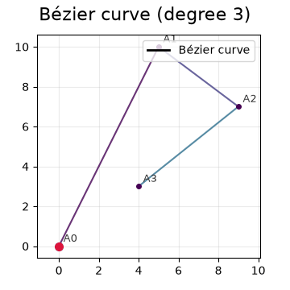
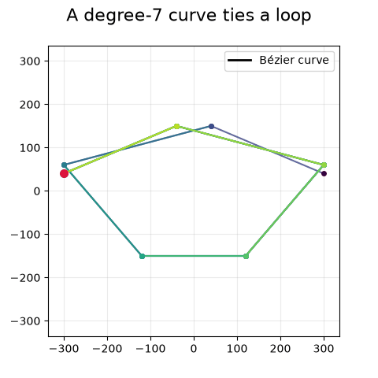
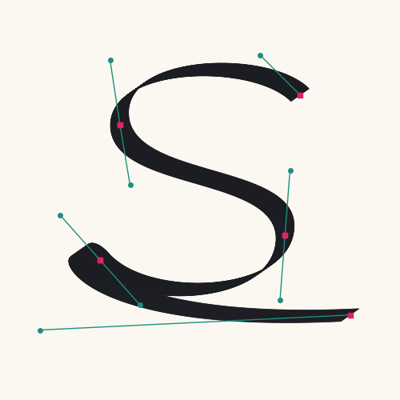
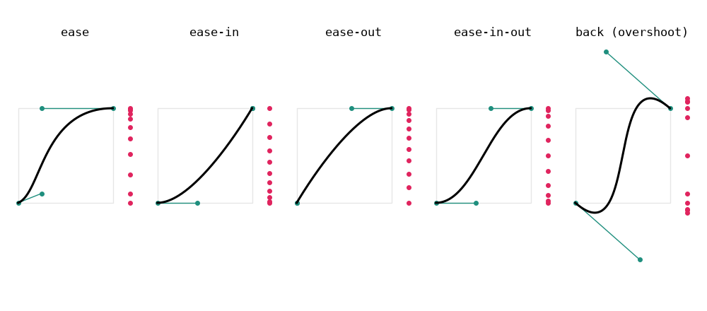
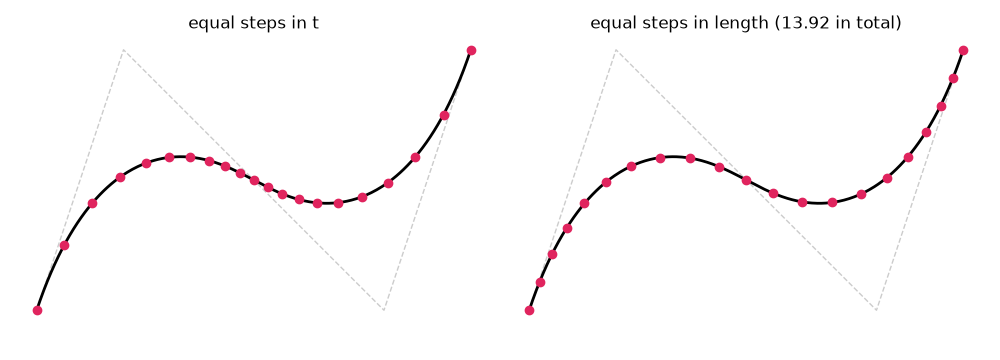
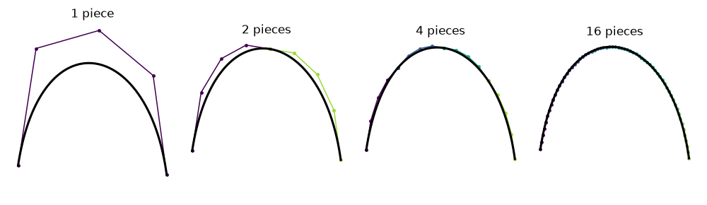

# beziervis

**Watch a Bézier curve build itself, and evaluate millions of curve points with a fast NumPy core.**

[](https://github.com/venkateshwara-gopisetti/Bezier-Curves/actions/workflows/tests.yml)
[](https://pypi.org/project/beziervis/)
[](https://pypi.org/project/beziervis/)
[](https://github.com/venkateshwara-gopisetti/Bezier-Curves/blob/master/LICENSE)
[](https://colab.research.google.com/github/venkateshwara-gopisetti/Bezier-Curves/blob/master/examples/quickstart.ipynb)

<p align="center">
  
</p>

- **For learning:** animate de Casteljau's algorithm level by level, then save it as a GIF or MP4 or play it inline in Jupyter.
- **For computing:** evaluate curves of any degree, in any dimension, singly or in batches of thousands. Under the hood this is a Bernstein-matrix NumPy core, with optional Numba kernels for a further 3–40× speed-up.
- **Small:** the only required dependency is NumPy. Animation and acceleration are opt-in extras.

[Quickstart notebook](https://colab.research.google.com/github/venkateshwara-gopisetti/Bezier-Curves/blob/master/examples/quickstart.ipynb) · [Gallery](#gallery) · [API](#api) · [CLI](#command-line) · [How it works](#how-de-casteljaus-algorithm-works) · [Performance](#performance) · [Contributing](https://github.com/venkateshwara-gopisetti/Bezier-Curves/blob/master/CONTRIBUTING.md) · [Changelog](https://github.com/venkateshwara-gopisetti/Bezier-Curves/blob/master/CHANGELOG.md)

## Install

```bash
pip install beziervis            # core: NumPy only
pip install "beziervis[all]"     # + Numba acceleration and matplotlib animations
```

| extra | adds | for |
|---|---|---|
| `[anim]` | matplotlib, Pillow | `animate()` and the `beziervis` command |
| `[fast]` | Numba | JIT and multi-threaded evaluation, used automatically |
| `[all]` | both | everything |

Requires Python 3.10 or newer. Tested on Linux, macOS and Windows.

## Quickstart

```python
import beziervis as bv

ctrl = [[0, 0], [5, 10], [9, 7], [4, 3]]       # 4 control points -> a cubic curve

pts = bv.points(ctrl, n=200)                   # (200, 2) NumPy array, from ctrl[0] to ctrl[-1]
bv.animate(ctrl, verbose=True).save("curve.gif")
```

<p align="center">
  
</p>

- **Input:** control points can be a list or a NumPy array of shape `(k, d)`, in any dimension `d`; the result has shape `(n, d)`.
- **Displaying:** `.show()` opens a window. In Jupyter, an animation that is the last expression in a cell plays inline.
- **Saving:** `.save()` writes `.gif` (Pillow) or `.mp4` (needs ffmpeg), and works on servers and in CI without a display.

## Gallery

Ten short, self-contained scripts in [`examples/`](https://github.com/venkateshwara-gopisetti/Bezier-Curves/tree/master/examples), each a few dozen lines. Click an image for its code.

<table>
  <tr><td align="center" width="33%"><a href="https://github.com/venkateshwara-gopisetti/Bezier-Curves/blob/master/examples/loop_animation.py"></a><br><sub><a href="https://github.com/venkateshwara-gopisetti/Bezier-Curves/blob/master/examples/loop_animation.py">A loop, every level drawn</a></sub></td><td align="center" width="33%"><a href="https://github.com/venkateshwara-gopisetti/Bezier-Curves/blob/master/examples/generative_art.py"></a><br><sub><a href="https://github.com/venkateshwara-gopisetti/Bezier-Curves/blob/master/examples/generative_art.py">3,000 curves in one call</a></sub></td><td align="center" width="33%"><a href="https://github.com/venkateshwara-gopisetti/Bezier-Curves/blob/master/examples/calligraphy.py"></a><br><sub><a href="https://github.com/venkateshwara-gopisetti/Bezier-Curves/blob/master/examples/calligraphy.py">Broad-nib calligraphy</a></sub></td></tr>
  <tr><td align="center" width="33%"><a href="https://github.com/venkateshwara-gopisetti/Bezier-Curves/blob/master/examples/easing.py"></a><br><sub><a href="https://github.com/venkateshwara-gopisetti/Bezier-Curves/blob/master/examples/easing.py">CSS easing curves</a></sub></td><td align="center" width="33%"><a href="https://github.com/venkateshwara-gopisetti/Bezier-Curves/blob/master/examples/curvature_comb.py"></a><br><sub><a href="https://github.com/venkateshwara-gopisetti/Bezier-Curves/blob/master/examples/curvature_comb.py">Curvature comb</a></sub></td><td align="center" width="33%"><a href="https://github.com/venkateshwara-gopisetti/Bezier-Curves/blob/master/examples/helix_3d.py"></a><br><sub><a href="https://github.com/venkateshwara-gopisetti/Bezier-Curves/blob/master/examples/helix_3d.py">A 3-D spring</a></sub></td></tr>
  <tr><td align="center" width="33%"><a href="https://github.com/venkateshwara-gopisetti/Bezier-Curves/blob/master/examples/heart.py"></a><br><sub><a href="https://github.com/venkateshwara-gopisetti/Bezier-Curves/blob/master/examples/heart.py">Two mirrored cubics</a></sub></td><td align="center" width="33%"><a href="https://github.com/venkateshwara-gopisetti/Bezier-Curves/blob/master/examples/arc_length.py"></a><br><sub><a href="https://github.com/venkateshwara-gopisetti/Bezier-Curves/blob/master/examples/arc_length.py">Even spacing by length</a></sub></td><td align="center" width="33%"><a href="https://github.com/venkateshwara-gopisetti/Bezier-Curves/blob/master/examples/subdivision.py"></a><br><sub><a href="https://github.com/venkateshwara-gopisetti/Bezier-Curves/blob/master/examples/subdivision.py">Recursive subdivision</a></sub></td></tr>
</table>

## API

| function | returns |
|---|---|
| `points(ctrl, n=100, t=None)` | `(n, d)` points at `n` evenly spaced `t` in [0, 1], or at the `t` values you pass |
| `points_batch(curves, n=100)` | `(m, n, d)` points for `m` curves of equal degree, given as `(m, k, d)` |
| `casteljau_steps(ctrl, t)` | every level of the construction: `[(k, d), (k-1, d), …, (1, d)]` |
| `split(ctrl, t=0.5)` | `(left, right)`: two curves of the same degree that join at `t` |
| `derivative(ctrl)` | control points of the derivative (hodograph) curve |
| `elevate(ctrl, times=1)` | the same curve with `times` more control points |
| `arc_length(ctrl)` | the curve's length (Gauss–Legendre quadrature, error around 1e-10) |
| `animate(ctrl, frames=100, verbose=False, …)` | a `BezierAnimation` with `.save()`, `.show()` and `.to_jshtml()` |
| `random_control_points(n, seed=None)` | `n` random integer points in [-100, 100) |
| `set_backend(name)` / `get_backend()` | choose or report the backend: `"numpy"`, `"numba"` or `"auto"` |

`animate()` also takes `labels`, `fps`, `hold` (frames to pause on the finished curve), `size` (pixels), `cmap` and `title`. Every function has a docstring with the details; try `help(bv.animate)`.

```python
import numpy as np

left, right = bv.split(ctrl, 0.5)
velocity    = bv.points(bv.derivative(ctrl), n=200)     # tangent vectors along the curve
length      = bv.arc_length(ctrl)
many        = bv.points_batch(np.random.rand(10_000, 4, 2), n=100)   # (10000, 100, 2)
```

## Command line

```bash
beziervis --points "0,0 5,10 9,7 4,3" --verbose --save curve.gif
beziervis -n 5 --seed 42                  # 5 random control points, reproducible
python -m beziervis --help                # same thing, without the script on PATH
```

| option | meaning |
|---|---|
| `-p, --points "x,y x,y …"` | control points (otherwise random) |
| `-n N` | number of random control points (default 4) |
| `--seed S` | random seed |
| `-v, --verbose` | draw the intermediate construction lines |
| `-f, --frames F` / `--fps R` | animation steps (default 100) and playback speed (default 30) |
| `--size PX` / `--no-labels` | figure size in pixels; hide point labels |
| `-s, --save FILE` | write `.gif` or `.mp4` instead of opening a window |

## How de Casteljau's algorithm works

A Bézier curve is defined by its control points (`A0 … A3` below). To find the point at parameter `t`:

1. Walk a fraction `t` along each edge of the control polygon. That gives one fewer point (`B0 … B2`).
2. Repeat on the new points (`C0, C1`), then again, until a single point is left.
3. That point (red) is on the curve. Sweep `t` from 0 to 1 and it traces the whole curve.


```python
steps = bv.casteljau_steps(ctrl, t=0.4)   # [A (4×2), B (3×2), C (2×2), point (1×2)]
```

The construction also splits a curve in two exactly: `A0, B0, C0` and the red point are the control points of the left half. This is how `split()` is implemented.

## Performance

Points are evaluated with a precomputed **Bernstein matrix** and one matrix multiply. Above degree 30, where that becomes numerically fragile, a **vectorised de Casteljau** is used instead. When Numba is installed, JIT-compiled kernels (multi-threaded for large inputs) are used automatically. Every backend agrees with the others to within 1e-12.

| case | naive Python | NumPy Bernstein | NumPy de Casteljau | Numba serial | Numba parallel |
|---|---|---|---|---|---|
| cubic, 1k points | 5.95 ms | 60 µs | 53.6 µs | 22.8 µs | 21.1 µs |
| cubic, 1M points | – | 71.5 ms | 79.2 ms | 25.9 ms | 10.6 ms |
| degree 10, 100k points | – | 21.4 ms | 52.4 ms | 7.93 ms | 2.33 ms |
| degree 50, 100k points | – | – | 1.02 s | 131 ms | 25 ms |
| 10k cubics × 100 points | – | 36.1 ms | – | – | 4.85 ms |

<sub>Best of 5 runs on Windows 11, Python 3.12, NumPy 2.5, Numba 0.68. To reproduce: `python benchmarks/bench.py`.</sub>

- **Choosing a backend:** set `BEZIERVIS_BACKEND=numpy|numba|auto` before import, or call `bv.set_backend(...)` at any time.
- **First Numba call:** it compiles the kernels, which takes about a second the first time and is then cached on disk.
- **Small inputs:** for a single curve with a few hundred points, every backend takes microseconds, so pick whichever you have installed.

## FAQ

**Saving `.mp4` fails.** MP4 needs [ffmpeg](https://ffmpeg.org/download.html) on your `PATH`. GIF needs only Pillow.

**The animation is cluttered with many control points.** Use `verbose=False`, which draws only the polygon and the curve, or `labels=False`. Labels switch off automatically above 10 points.

**Can I animate 3-D curves?** Not yet; `animate()` draws 2-D curves. The maths functions (`points`, `split`, `derivative`, …) work in any dimension. 3-D animation is on the [roadmap](https://github.com/venkateshwara-gopisetti/Bezier-Curves/issues).

**How does this compare with the [`bezier`](https://pypi.org/project/bezier/) package?** `bezier` is a mature computational-geometry library with curve intersection, surfaces and a compiled core, and the right choice for CAD-grade geometry. beziervis is smaller and focused on teaching and visualising the construction, plus fast batch evaluation in pure NumPy or Numba.

## Contributing

Bug reports, ideas and pull requests are welcome. See [CONTRIBUTING.md](https://github.com/venkateshwara-gopisetti/Bezier-Curves/blob/master/CONTRIBUTING.md) for setup, tests and style. Issues labelled [good first issue](https://github.com/venkateshwara-gopisetti/Bezier-Curves/labels/good%20first%20issue) are a good place to start.

```bash
git clone https://github.com/venkateshwara-gopisetti/Bezier-Curves && cd Bezier-Curves
pip install -e ".[dev]" && pytest
```

## Citation

If beziervis helps your research or teaching, please cite it. GitHub's "Cite this repository" button (from [`CITATION.cff`](https://github.com/venkateshwara-gopisetti/Bezier-Curves/blob/master/CITATION.cff)) gives BibTeX and APA.

## License

[MIT](https://github.com/venkateshwara-gopisetti/Bezier-Curves/blob/master/LICENSE) © Venkateshwara Gopisetti
