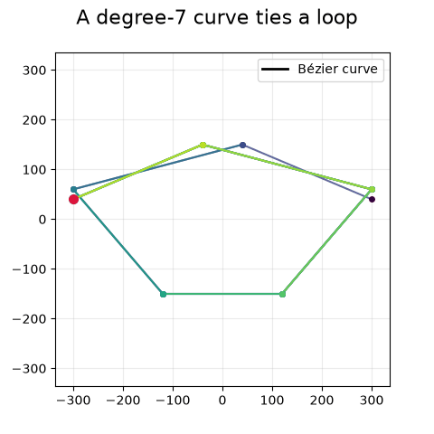
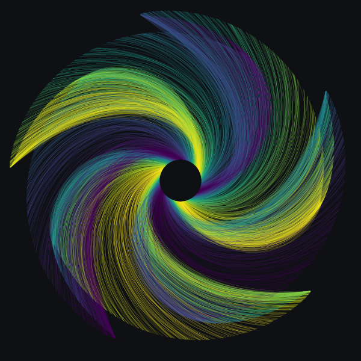
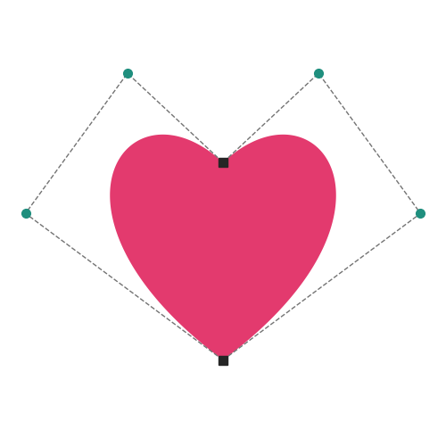
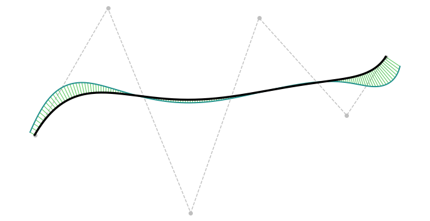
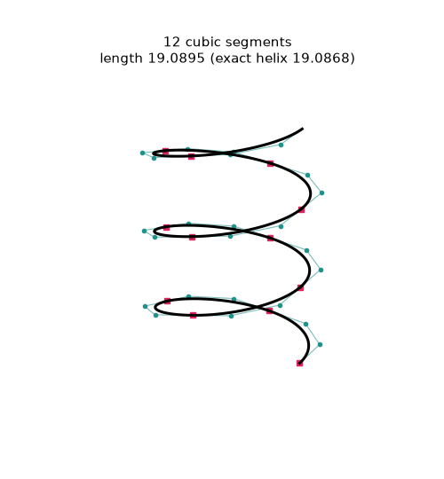

# Examples

Each script is self-contained and writes one image to the current directory:

```bash
pip install "beziervis[anim]"
python examples/heart.py          # -> heart.png
```

To regenerate every image in [`docs/assets/gallery/`](../docs/assets/gallery), run `python docs/make_assets.py`. For an interactive tour, open [`quickstart.ipynb`](quickstart.ipynb).

| script | shows | uses |
|---|---|---|
| [`loop_animation.py`](loop_animation.py) | a degree-7 curve tying a loop, with all seven construction levels | `animate(verbose=True)` |
| [`generative_art.py`](generative_art.py) | 3,000 swirling cubics evaluated in a single call | `points_batch()` |
| [`calligraphy.py`](calligraphy.py) | an "S" written with a broad-nib pen along smoothly joined cubic segments | `points()` |
| [`heart.py`](heart.py) | a heart from two mirrored cubics, as in fonts and vector graphics | `points()` |
| [`easing.py`](easing.py) | CSS `cubic-bezier()` timing functions, and how to evaluate them | `points()` |
| [`curvature_comb.py`](curvature_comb.py) | a CAD-style curvature comb | `derivative()` |
| [`arc_length.py`](arc_length.py) | equal steps in t compared with equal steps in distance | `arc_length()`, `split()` |
| [`subdivision.py`](subdivision.py) | splitting a curve in half again and again | `split()` |
| [`degree_elevation.py`](degree_elevation.py) | the same curve with more and more control points | `elevate()` |
| [`helix_3d.py`](helix_3d.py) | a 3-D spring from quarter-turn cubics, measured against the exact helix | 3-D `points_batch()`, `arc_length()` |

<p>
  
  
  
  
  
  
</p>

Have a nice example? Pull requests are welcome; see [CONTRIBUTING.md](../CONTRIBUTING.md). Each new script needs a `main(out_dir=".")` function that saves its image and returns the path, so the gallery builder and the tests can run it.
